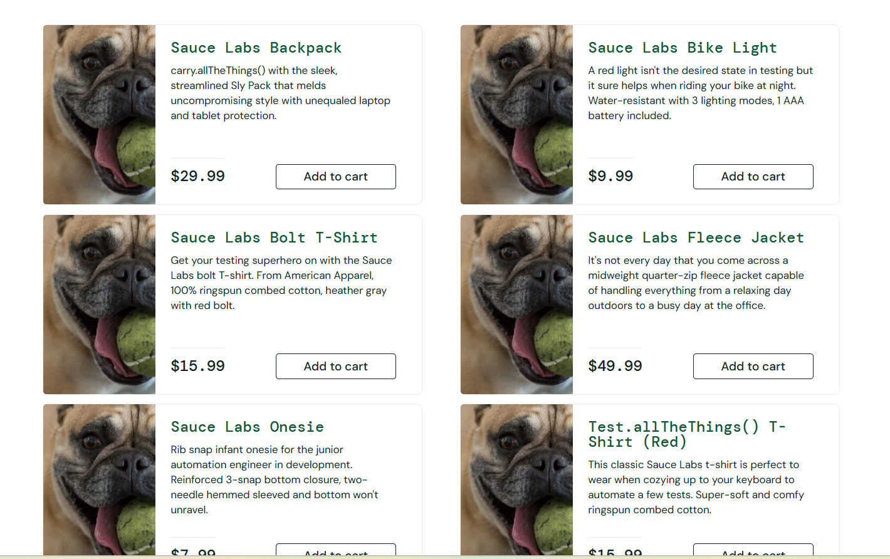
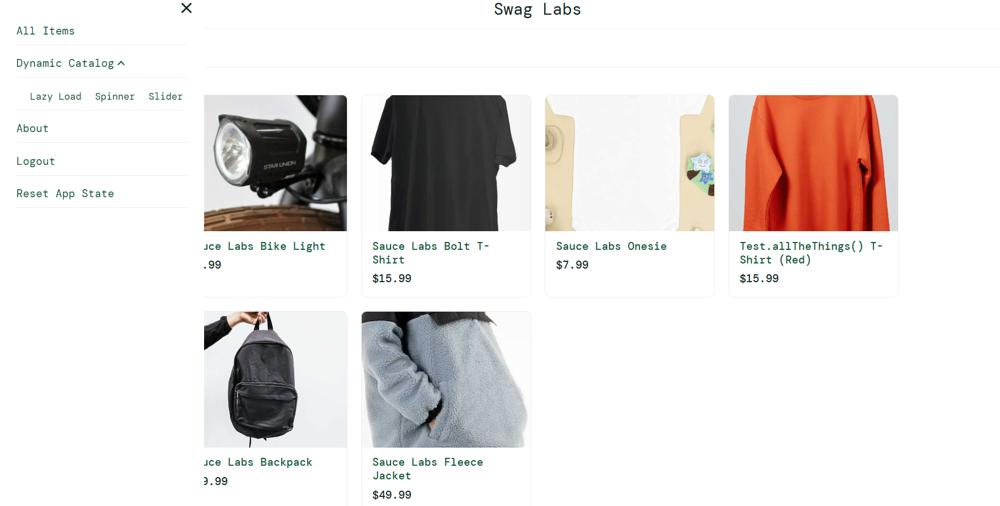
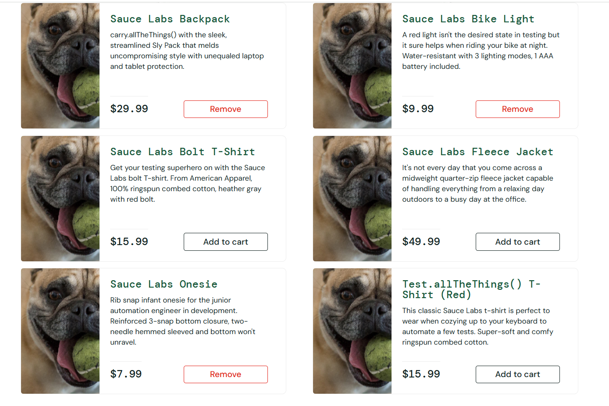
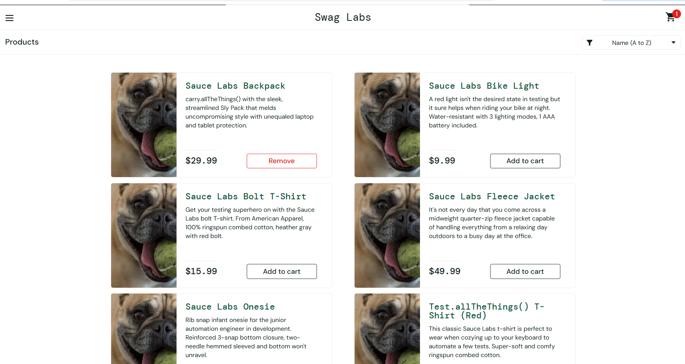
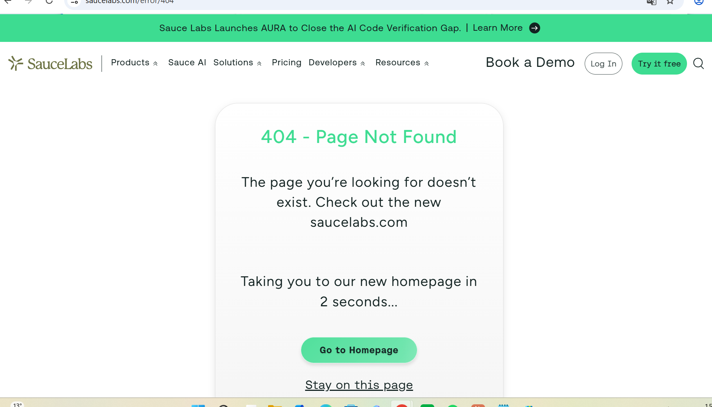
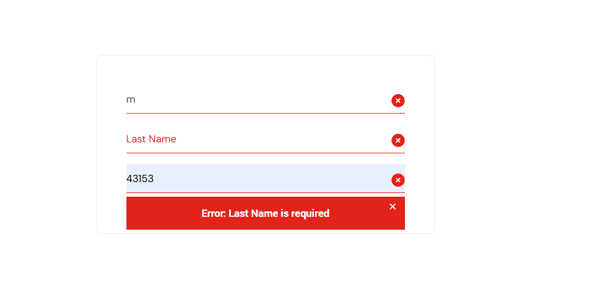

# SauceDemo (problem_user) — Bug Reports

## BUG-01: All products show the same dog image on the product list

-  **Environment:** Google Chrome, saucedemo.com, logged in as `problem_user`
- **Steps to reproduce:**
  1. open google chrome
  2. open up saucedemo.com on google chrome
  3. type in problem_user in the username box
  4. type in secret_sauce in the password box
  5. press the login button and get directed to the home page
  6. look at the product images on the product list
- **Expected result:** the different items should have their own product images
- **Actual result:** All the different items has the same product image of a dog
- **Severity:** medium - customers can still buy, but can't tell the products apart.
- **Priority:** medium - not a critical issue, but will ruin the customer experience.
- **Evidence:**  

## BUG-02: only possible to add 3 items in your cart

-  **Environment:** Google Chrome, saucedemo.com, logged in as `problem_user`
- **Steps to reproduce:**
  1. open google chrome
  2. open up saucedemo.com on google chrome
  3. type in problem_user in the username box
  4. type in secret_sauce in the password box
  5. press the login button and get directed to the home page
  6. add all 6 items in the cart by pressing add item
- **Expected result:** all items should be in your cart when adding them 
- **Actual result:** only a selected 3 items could be added to the cart backpack, bike light and onesie. bolt t-shirt, fleece jacket and test.allthethings t-shirt all could not be added and still shows the add item button.
- **Severity:** high - customers can still buy, but they can't choose their items freely.
- **Priority:** high - will ruin the customer experience and affect sales.
- **Evidence:** 

## BUG-03: the remove button that appears after adding an item to your cart does not work

-  **Environment:** Google Chrome, saucedemo.com, logged in as `problem_user`
- **Steps to reproduce:**
  1. open google chrome
  2. open up saucedemo.com on google chrome
  3. type in problem_user in the username box
  4. type in secret_sauce in the password box
  5. press the login button and get directed to the home page
  6. add any item in the cart by pressing add item 
  7. now remove the same item with the remove item button that appears when adding items in the cart.
- **Expected result:** all items should be removed after pressing the remove button
- **Actual result:** the items could not be removed when pressing the remove button, but the item can still be removed from the cart page.
- **Severity:** low - customers can still buy, the user experience might be affected but not too much since they could still remove the items from the shopping cart page.
- **Priority:** low - might ruin the customer experience a little, but not enough for it to affect sales.
- **Evidence:** 

## BUG-04: 404 error code when pressing the about button in the menu - only with problem_user

-  **Environment:** Google Chrome, saucedemo.com, logged in as `problem_user`
- **Steps to reproduce:**
  1. open google chrome
  2. open up saucedemo.com on google chrome
  3. type in problem_user in the username box
  4. type in secret_sauce in the password box
  5. press the login button and get directed to the home page
  6. open the menu to the left
  7. press the about button 
- **Expected result:** it should open sauce labs homepage
- **Actual result:** saucelabs.com/error/404 page could not be found - this does not occur with standard_user only problem_user.
- **Severity:** low - no function is broken; the About link leads to an external info page that shows 404, while logging in, browsing and buying all still work.
- **Priority:** medium - the broken link sits in the main menu, so users affected by this bug run into it right away, which reflects badly on the product even though the impact is small.
- **Evidence:** 

## BUG-05: when checking out, you can't fill in your last name - this gives an error message that the last name is required
-  **Environment:** Google Chrome, saucedemo.com, logged in as `problem_user`
- **Steps to reproduce:**
  1. open google chrome
  2. open up saucedemo.com on google chrome
  3. type in problem_user in the username box
  4. type in secret_sauce in the password box
  5. press the login button and get directed to the home page
  6. add the items sauce labs backpack and sauce labs bike light to your cart
  7. press the shopping cart icon on the top right
  8. after seeing your items in the cart press the checkout button
  9. fill in your first name
  10. click in the last name box and try to type a last name
  11. fill in your zip-code
  12. press continue
- **Expected result:** should check-out your cart and go to the checkout overview page
- **Actual result:** last name can't be filled in, when trying the text ends up into the first name box and the last name box stays empty and when pressing continue you get an error message saying error: last name is required.
- **Severity:** high - if a customer can't buy anything the company won't be able to make sales.
- **Priority:** high - needs to be fixed as soon as possible so that saucedemo can keep up with sales.
- **Evidence:** 